# Dockerized App with Automated CI/CD Pipeline

[](https://www.python.org/)
[](https://flask.palletsprojects.com/)
[](https://gunicorn.org/)
[](https://www.docker.com/)
[](https://github.com/features/actions)
[](https://hub.docker.com/)
[](https://docs.pytest.org/)

An enterprise-grade continuous integration and continuous deployment (CI/CD) reference architecture demonstrating how to containerize a Python Flask microservice using production-hardened Docker standards and automate its testing, building, validation, and container image publishing to **Docker Hub** using **GitHub Actions**.

Every code push and pull request undergoes automated code-quality linting, unit testing, container compilation via Docker Buildx with GitHub Actions layer caching, live container health smoke-checks, and immutable semantic tagging (`latest` and `sha-<commit>`).

---

## Table of Contents

- [CI/CD Pipeline Architecture](#cicd-pipeline-architecture)
- [Microservice Application Overview](#microservice-application-overview)
  - [API Endpoints Reference](#api-endpoints-reference)
  - [Environment Variables Configuration](#environment-variables-configuration)
  - [Production WSGI Server (Gunicorn)](#production-wsgi-server-gunicorn)
- [Docker Container Engineering & Security](#docker-container-engineering--security)
  - [CIS Docker Benchmark Hardening](#cis-docker-benchmark-hardening)
  - [Native Docker HEALTHCHECK](#native-docker-healthcheck)
  - [Build Context Optimization (`.dockerignore`)](#build-context-optimization-dockerignore)
- [GitHub Actions Pipeline Engineering](#github-actions-pipeline-engineering)
  - [Workflow Stages & Jobs](#workflow-stages--jobs)
  - [Multi-Platform & Buildx Caching](#multi-platform--buildx-caching)
  - [Semantic Versioning & Image Tagging](#semantic-versioning--image-tagging)
- [Local Development & Testing Guide](#local-development--testing-guide)
  - [Option A: Python Virtual Environment](#option-a-python-virtual-environment)
  - [Option B: Running via Docker](#option-b-running-via-docker)
  - [Option C: Running via Docker Compose](#option-c-running-via-docker-compose)
- [Configuring GitHub Actions Secrets for Docker Hub](#configuring-github-actions-secrets-for-docker-hub)
- [Production Runbook & Rollback Strategy](#production-runbook--rollback-strategy)
- [Troubleshooting Matrix](#troubleshooting-matrix)

---

## CI/CD Pipeline Architecture

```mermaid
sequenceDiagram
    autonumber
    actor Developer as Software Engineer
    participant Git as GitHub Repository
    participant Runner as GitHub Actions Runner
    participant Flake as Flake8 Linter
    participant Pytest as Pytest Test Suite
    participant Buildx as Docker Buildx Engine
    participant Registry as Docker Hub Registry

    Developer->>Git: git push origin main
    Git->>Runner: Trigger Workflow (ci-cd.yml)
    
    rect rgb(20, 30, 45)
        Note over Runner,Pytest: Stage 1: Continuous Integration (Lint & Test)
        Runner->>Runner: Checkout code & setup Python 3.11
        Runner->>Flake: Run syntax & PEP8 style verification
        Flake-->>Runner: Quality checks passed
        Runner->>Pytest: Run unit & integration test suite
        Pytest-->>Runner: 100% tests passing
    end

    rect rgb(20, 45, 30)
        Note over Runner,Registry: Stage 2: Continuous Delivery (Build & Publish)
        Runner->>Buildx: Setup QEMU & Docker Buildx
        Runner->>Registry: Authenticate via DOCKERHUB_TOKEN
        Buildx->>Buildx: Build image with GHA layer cache
        Runner->>Runner: Spin up test container & run HTTP smoke check
        Runner-->>Runner: GET /health returns 200 OK
        Runner->>Registry: Push image: <username>/flask-cicd-app:latest
        Runner->>Registry: Push image: <username>/flask-cicd-app:sha-<hash>
    end

    Registry-->>Developer: New release available on Docker Hub
```



---

## Microservice Application Overview

The microservice is built using **Flask 3.0** and served by **Gunicorn 22.0**. It exposes a modern responsive operational UI alongside REST endpoints for container orchestrators (such as Kubernetes or Amazon ECS).

### API Endpoints Reference

| Endpoint | HTTP Method | Response Format | Purpose | Sample Response Payload |
| :--- | :--- | :--- | :--- | :--- |
| `/` | `GET` | `text/html` | User dashboard | Responsive HTML UI displaying host, version, and server timestamp. |
| `/health` | `GET` | `application/json` | Liveness & Readiness probe | `{"environment":"production","status":"healthy","timestamp":"2026-11-05T03:00:00Z","version":"1.0.0"}` |
| `/api/info` | `GET` | `application/json` | Service discovery metadata | `{"app_name":"Dockerized Flask CI/CD Demo","hostname":"flask-app","runtime":"Python 3.11 / Gunicorn","version":"1.0.0"}` |

### Environment Variables Configuration

The application is completely configurable via twelve-factor environment variables:

| Variable | Default Value | Description |
| :--- | :--- | :--- |
| `PORT` | `5000` | Port on which the Gunicorn server listens |
| `APP_ENV` | `production` | Active environment identifier (`production`, `staging`, `development`) |
| `APP_VERSION` | `1.0.0` | Semantic version string injected into telemetry endpoints |
| `PYTHONUNBUFFERED` | `1` | Forces stdout and stderr streams to be unbuffered for real-time logging |
| `PYTHONDONTWRITEBYTECODE` | `1` | Prevents Python from writing `.pyc` files inside the container |

### Production WSGI Server (Gunicorn)

The application avoids Flask's single-threaded development server in favor of Gunicorn:
```bash
gunicorn --bind 0.0.0.0:5000 --workers 2 --threads 2 --timeout 30 app.main:app
```
- **Concurrency**: 2 worker processes with 2 threads each handling concurrent HTTP transactions.
- **Graceful Timeouts**: Worker restart thresholds configured to prevent memory leak accumulation.

---

## Docker Container Engineering & Security

### CIS Docker Benchmark Hardening

The provided [`Dockerfile`](Dockerfile) follows container security best practices:

```dockerfile
# 1. Official Minimal Base Image
FROM python:3.11-slim AS base

# 2. Strict non-root execution (Least Privilege)
RUN useradd -u 1001 -m appuser && \
    chown -R appuser:appuser /app
USER appuser

# 3. Built-in container health check
HEALTHCHECK --interval=30s --timeout=5s --start-period=5s --retries=3 \
    CMD curl -f http://localhost:5000/health || exit 1
```

1. **Non-Root Execution**: By creating a dedicated unprivileged user (`appuser` with UID 1001), container breakout vulnerabilities are mitigated since the process lacks root privileges on the host kernel.
2. **Minimal Surface Area**: `python:3.11-slim` avoids build utilities, compilers, and bloat packages, shrinking total image size to under 150MB.
3. **No Root Package Caching**: `pip install --no-cache-dir` discards installation tarballs, preventing image layer bloat.

### Native Docker HEALTHCHECK

The container exposes a self-contained health check probe:
- **Interval (`30s`)**: Probes `/health` every 30 seconds.
- **Timeout (`5s`)**: Fails if the application takes longer than 5 seconds to respond.
- **Retries (`3`)**: Marks the container `unhealthy` after 3 consecutive failures.
- **Start Period (`5s`)**: Grants the WSGI workers initialization grace time before counting probe failures.

### Build Context Optimization (`.dockerignore`)

The [`.dockerignore`](.dockerignore) prevents development artifacts (`.git`, `__pycache__`, `.pytest_cache`, `.venv`, and `*.log`) from leaking into the build context, speeding up transfer time to the Docker daemon.

---

## GitHub Actions Pipeline Engineering

The automated workflow [`.github/workflows/ci-cd.yml`](.github/workflows/ci-cd.yml) executes on every push and pull request.

### Workflow Stages & Jobs

#### 1. Job: `test` (Continuous Integration)
- Spins up an `ubuntu-latest` runner.
- Configures Python 3.11 with pip caching.
- Executes `flake8` to enforce clean syntax, zero syntax errors, and bounded code complexity ($\le 10$).
- Executes `pytest -v tests/` to validate:
  - Landing page loads with HTTP 200 and expected markup.
  - `/health` endpoint responds with valid JSON and `status: healthy`.
  - `/api/info` responds with expected microservice attributes.

#### 2. Job: `build-and-publish` (Continuous Delivery)
- Runs strictly on merge/push to `main` or `master` branch.
- Sets up **Docker Buildx** and **QEMU** for high-efficiency container building.
- Logs in to Docker Hub using encrypted repository secrets.
- Compiles the container utilizing **GitHub Actions Layer Caching** (`cache-from: type=gha`, `cache-to: type=gha,mode=max`).
- **Live Smoke Test**: Starts a detached test container on the runner, curls `http://localhost:5000/health`, and asserts a 200 OK before pushing to Docker Hub.
- Publishes dual-tagged images to Docker Hub.

### Semantic Versioning & Image Tagging

Every image pushed to Docker Hub receives two tags:
1. **`latest`**: Points to the most recently built commit on the `main` branch.
2. **`sha-<short_commit_hash>`** (e.g., `sha-a61dfea`): Immutable release tag linking the container directly to its source git commit for auditability and rollbacks.

---

## Local Development & Testing Guide

### Option A: Python Virtual Environment

```bash
# Clone the repository
git clone https://github.com/RudraliS/docker-flask-cicd-pipeline.git
cd docker-flask-cicd-pipeline

# Create and activate virtual environment
python -m venv venv
source venv/bin/activate       # On Linux/macOS
# .\venv\Scripts\Activate.ps1  # On Windows PowerShell

# Install dependencies
pip install --upgrade pip
pip install -r requirements.txt
pip install -r requirements-dev.txt

# Run linter
flake8 app tests

# Run unit tests
pytest -v tests/

# Run application locally
python app/main.py
```
Open [http://localhost:5000](http://localhost:5000) in your browser.

---

### Option B: Running via Docker

```bash
# 1. Build the local image
docker build -t flask-cicd-app:local .

# 2. Run container in detached mode
docker run -d -p 5000:5000 --name my-flask-app flask-cicd-app:local

# 3. Verify running container and health status
docker ps

# 4. Check application logs
docker logs -f my-flask-app

# 5. Stop and clean up container
docker stop my-flask-app && docker rm my-flask-app
```

---

### Option C: Running via Docker Compose

```bash
# Launch application with healthchecks
docker compose up -d

# Check live logs
docker compose logs -f

# Verify health status
docker compose ps

# Shutdown
docker compose down
```

---

## Configuring GitHub Actions Secrets for Docker Hub

To enable automated publishing from your repository to your Docker Hub account:

### 1. Create a Docker Hub Access Token
1. Log in to [Docker Hub](https://hub.docker.com/).
2. Click your avatar in the top-right corner > **Account Settings**.
3. Select **Security** > **New Access Token**.
4. Description: `github-actions-cicd` | Access permissions: **Read & Write**.
5. Copy the generated token string.

### 2. Add Secrets to GitHub Repository
1. Navigate to your repository: [github.com/RudraliS/docker-flask-cicd-pipeline](https://github.com/RudraliS/docker-flask-cicd-pipeline).
2. Go to **Settings** > **Secrets and variables** > **Actions**.
3. Click **New repository secret** and define:
   - Name: `DOCKERHUB_USERNAME` | Value: Your Docker Hub username.
   - Name: `DOCKERHUB_TOKEN` | Value: The access token copied from Step 1.

### 3. Trigger the Pipeline
Commit a change and push to `main`:
```bash
git add .
git commit -m "ci: trigger automated build and publish"
git push origin main
```
Navigate to the **Actions** tab in GitHub to watch the workflow build, test, and publish.

---

## Production Runbook & Rollback Strategy

### Pulling and Running the Published Image
Once published to Docker Hub, deploy anywhere:

```bash
# Pull the latest image
docker pull <YOUR_DOCKERHUB_USERNAME>/flask-cicd-app:latest

# Run in production
docker run -d \
    --restart unless-stopped \
    -p 5000:5000 \
    -e APP_ENV=production \
    --name production-web \
    <YOUR_DOCKERHUB_USERNAME>/flask-cicd-app:latest
```

### Production Rollback Procedure
If a regression or bug is identified in the `latest` build, perform an instant rollback to a known good state using the immutable commit SHA tag:

```bash
# Stop current faulty container
docker stop production-web && docker rm production-web

# Deploy previous stable commit SHA
docker run -d \
    --restart unless-stopped \
    -p 5000:5000 \
    -e APP_ENV=production \
    --name production-web \
    <YOUR_DOCKERHUB_USERNAME>/flask-cicd-app:sha-a61dfea
```

---

## Troubleshooting Matrix

| Issue | Potential Cause | Diagnostic Check | Resolution |
| :--- | :--- | :--- | :--- |
| **Flake8 lint failure** | Syntax error, unused imports, line $>120$ chars. | `flake8 app tests` | Fix formatting or remove unused imports. |
| **Pytest failure** | Broken endpoint or changed JSON payload schema. | `pytest -v tests/` | Update test assertions in `tests/test_app.py`. |
| **Docker Hub 401 Unauthorized** | Missing or incorrect GitHub repository secrets. | GitHub Actions logs for `Log in to Docker Hub` | Re-verify `DOCKERHUB_USERNAME` and `DOCKERHUB_TOKEN` in repo settings. |
| **Smoke check failure in CI** | WSGI failed to bind or `/health` returned non-200. | GitHub Actions logs for `Run Basic Health Check` | Inspect Gunicorn startup flags and check application port binding. |
| **Container unhealthy in `docker ps`** | Missing `curl` utility or endpoint timeout. | `docker inspect --format='{{json .State.Health}}' <id>` | Verify curl is installed in `Dockerfile` and endpoint responds within 5s. |
